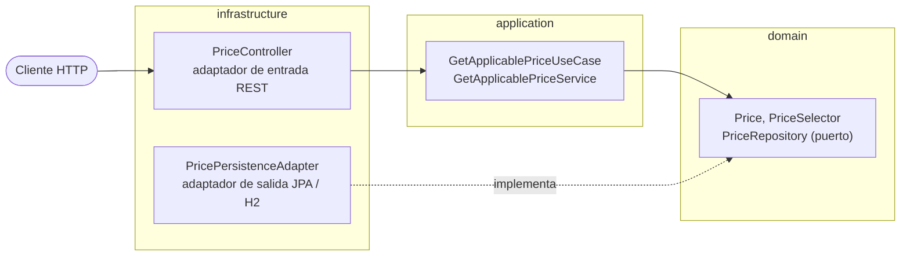

# Prices Service

[](https://github.com/rbejerano-84/test-ITX-sdd/actions/workflows/build.yml)

Servicio REST para consultar el precio aplicable a un producto y una cadena en una fecha y hora determinada. El contrato de la API es [`src/main/resources/openapi/prices-api.yaml`](src/main/resources/openapi/prices-api.yaml).

## Arquitectura

Arquitectura hexagonal. El dominio no depende de ningún framework y las dependencias apuntan siempre hacia dentro (lo verifica `ArchitectureTest`).



```text
com.example.prices
├── domain                      Modelo y reglas de negocio, sin frameworks
├── application                 Caso de uso
└── infrastructure
    ├── adapter.in.rest         Controlador, mapper y gestión de errores
    ├── adapter.out.persistence Entidad JPA y adaptador del repositorio
    └── config                  Cableado de beans
```

## Requisitos

- JDK 21.
- Maven Wrapper incluido (`mvnw.cmd` en Windows).

## Build y pruebas

Desde PowerShell en la raíz del proyecto:

```powershell
.\mvnw.cmd clean verify
```

`verify` genera y compila la interfaz OpenAPI, ejecuta las pruebas unitarias, de aplicación, persistencia, MVC, aceptación, E2E y contrato, aplica las reglas ArchUnit, comprueba el formato con Spotless y exige al menos un 80% de cobertura de líneas JaCoCo. Los DTO generados por OpenAPI se excluyen del cálculo de cobertura. `PriceEndToEndTest` inicia el servidor en un puerto aleatorio y hace peticiones HTTP reales.

Comandos útiles:

```powershell
.\mvnw.cmd test
.\mvnw.cmd -Dtest=PriceAcceptanceTest test
.\mvnw.cmd -Dtest=PriceApiContractTest test
.\mvnw.cmd generate-sources
```

La suite de contrato valida respuestas reales `200`, `400` y `404` contra el YAML y comprueba que detecta un cuerpo inválido. El servicio usa `LocalDateTime` sin offset por el supuesto S-1; por ello, el validador omite únicamente la comprobación RFC 3339 de `format: date-time`, manteniendo el resto de las validaciones del esquema.

## Ejecución local

```powershell
.\mvnw.cmd spring-boot:run
```

H2 se crea en memoria e inicializa el esquema y los cuatro registros de referencia desde `src/main/resources/schema.sql` y `src/main/resources/data.sql`.

## Posibles evoluciones

Caché de consultas de tarifas (por ejemplo con Caffeine) si el volumen de lecturas lo justificara; con la H2 en memoria actual no aporta mejora medible.

## Consultar un precio

```powershell
curl.exe "http://localhost:8080/api/v1/prices?applicationDate=2020-06-14T10:00:00&productId=35455&brandId=1"
```

La respuesta incluye `productId`, `brandId`, `priceList`, `startDate`, `endDate`, `price` y `currency`. Para el ejemplo, la lista aplicable es `1`, el precio es `35.50` y la moneda es `EUR`. Si falta o es inválido un parámetro se devuelve `400`; si no hay una tarifa aplicable, `404`.

## Escenarios de referencia

Datos de la prueba: producto `35455`, cadena `1`. Cada fila está cubierta por un test de aceptación y otro de extremo a extremo.

| # | applicationDate | priceList | price |
|---|---|---|---|
| 1 | 2020-06-14T10:00:00 | 1 | 35.50 |
| 2 | 2020-06-14T16:00:00 | 2 | 25.45 |
| 3 | 2020-06-14T21:00:00 | 1 | 35.50 |
| 4 | 2020-06-15T10:00:00 | 3 | 30.50 |
| 5 | 2020-06-16T21:00:00 | 4 | 38.95 |

## Supuestos del producto

- **S-1 — Hora local:** `applicationDate` se interpreta como fecha y hora local, sin zona ni offset.
- **S-2 — Vigencia inclusiva:** el precio es aplicable tanto en `startDate` como en `endDate`.
- **S-3 — Datos y moneda:** se usan los cuatro registros de referencia; sus precios están expresados en EUR y producen los cinco resultados de la especificación.
- **S-4 — Selección determinista:** gana la tarifa de mayor prioridad; si hay empate, gana el `priceList` mayor.
- **S-5 — Alcance:** el servicio solo consulta precios existentes; no crea tarifas, convierte monedas, autentica clientes ni limita peticiones.

Los identificadores de producto y cadena deben ser positivos. Las respuestas `401`, `403`, `429` y `503` documentadas en el contrato corresponden al gateway o a la infraestructura, no a mecanismos implementados por esta aplicación.

## Decisiones de diseño

- **ADR-01 — Selección en dominio:** persistencia filtra las tarifas candidatas por cadena, producto y vigencia; el dominio aplica la selección por prioridad y desempata por `priceList`. La regla no se duplica en SQL.
- **R-02 — Timestamps locales:** dominio, persistencia y REST usan `LocalDateTime`, sin conversión de zona horaria. La generación OpenAPI mapea `date-time` a `LocalDateTime`.
- **R-03 — Contrato generado:** OpenAPI es la fuente de verdad; Maven genera la interfaz y los DTOs bajo `target/generated-sources/openapi`. Los archivos generados no se versionan.
- **R-04 — Persistencia:** H2 en memoria carga los datos de referencia mediante `schema.sql` y `data.sql`; no se necesita un migrador para este alcance.
- **R-05 — Errores:** un único `@RestControllerAdvice` devuelve Problem Details; los errores inesperados no exponen información interna.
- **R-06 — Seguridad e infraestructura:** la aplicación no implementa autenticación ni rate limiting; las respuestas externas se mantienen documentadas en el contrato.

## Cómo se desarrolló

El servicio se desarrolló con spec-driven development: la especificación, el plan, el modelo de datos y las tareas están en [`specs/001-consulta-precios/`](specs/001-consulta-precios/), y los principios del proyecto en [`.specify/memory/constitution.md`](.specify/memory/constitution.md). El historial de commits sigue ciclos TDD (test en rojo, implementación, refactor).
